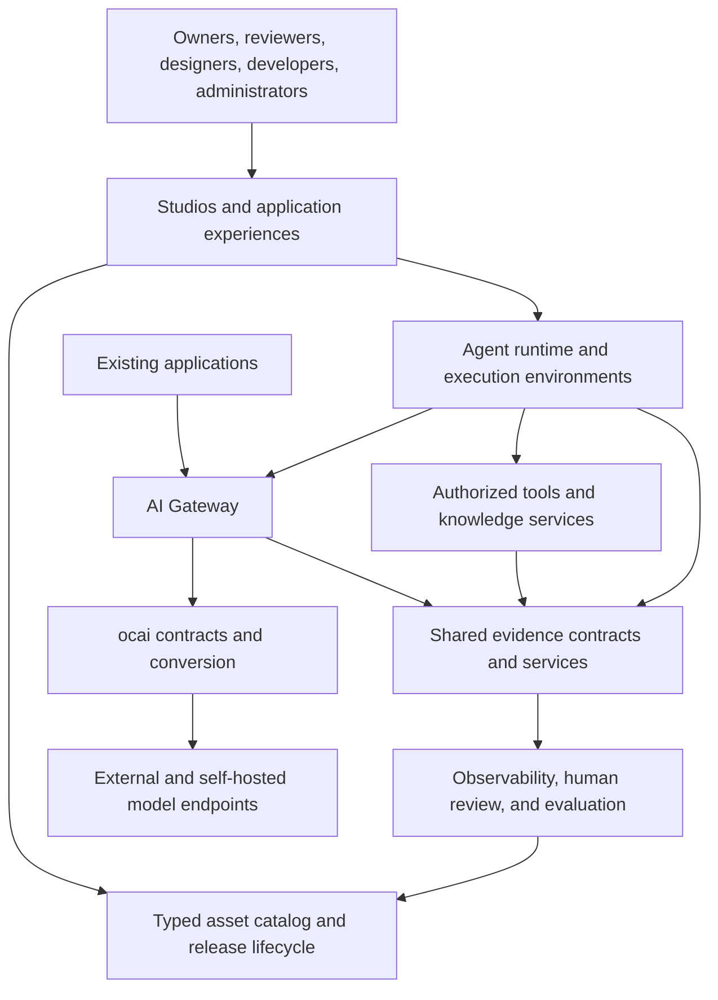

# Enterprise AI platform vision

> **Proposed design, not a usage guide.** Original research/design dates are retained.
> Implementation status comes from [the roadmap](../../plans/README.md) and
> [qualified user documentation](../../user/index.md).

Status: product direction and proposed design, recorded 2026-11-10.

The platform will let enterprises build, operate, evaluate, and govern AI
applications, with traceability from their definitions to production outcomes.
ocai is its independently usable contract and conversion kernel. The AI Gateway
is the first planned platform product; observability, evaluation, catalogs,
agent authoring, and execution build on shared contracts exercised there.

The agreed launch direction is customer-hosted first, with managed hosting
later. The initial target is a platform team standardizing model access,
governance, and costs, paired with one concrete application. A domain knowledge
assistant is the proposed pilot example; the partner and exact domain remain
open.

The central experience is being able to establish: this application version
used these approved assets, executed under this policy, performed these actions,
incurred this measured or estimated cost, and produced these evaluated outcomes.
An unknown fact stays unknown; a trace or evaluation score is not proof of an
outcome it did not observe.

## Reading guide

| Document | Purpose |
|---|---|
| [Product portfolio](products.md) | Users, product responsibilities, longer-term modules, and positioning |
| [AI Gateway](gateway.md) | First product, fidelity policies, routing, receipts, and production qualification |
| [Platform stack and console](stack.md) | Selected technologies, reusable frontend layers, and management boundaries |
| [Identity and access](identity.md) | OIDC/SAML/local login, Keycloak selection, browser/backend boundaries, service accounts and delegation |
| [Security and enterprise trust](security.md) | Proposed controls, verification, release gates, and customer evidence |
| [Evidence and observability](evidence.md) | Identity, telemetry, audit, accounting, evaluation, and privacy |
| [Compartments and knowledge](compartments.md) | Isolation, controlled sharing, domain packages, and retrieval |
| [Catalogs and studios](authoring.md) | Typed assets, prompt/skill studios, human evaluation, and release lifecycle |
| [Agent execution](execution.md) | Definitions, profiles, environments, custom agents, and application experiences |
| [Delivery and qualification](delivery.md) | Proposed sequence, dependencies, demonstrations, and promotion gates |
| [Direction and open decisions](decisions.md) | Agreed product intent, proposed choices, and unanswered questions |
| [Repository layout ADR](../../decisions/0006-platform-product-layout.md) | Accepted separation of distributed libraries and platform products |

## Status and authority

The direction agreed in the product discussion is captured in
[the direction register](decisions.md). Detailed behavior throughout this
directory is a design proposal unless it explicitly describes an existing
kernel boundary or an accepted ADR. Product names are working names, not package names or
commercial editions. There are no delivery dates or promised support levels.

- [Architecture](../../architecture.md) remains the structural contract for ocai.
- [Plans](../../plans/README.md) remain the only authoritative implementation
  queue. This vision neither completes nor replaces an existing work unit.
- [Gateway readiness](../../plans/gateway-readiness.md) and the
  [integration guide](../../user/gateway-integration.md) track package prerequisites and
  qualification. Implementation checkboxes do not replace merge/release evidence.
- [Feature matrix](../../user/provider-feature-matrix.md) describes implemented provider
  support. A proposal, fixture, or schema alone does not establish runtime support.
- [ADRs](../../decisions/README.md) record settled engineering decisions. Promote
  proposed boundaries and policies there when their alternatives and evidence
  have been reviewed; add their tests in the implementing WU.

## Platform structure

Arrows show principal relationships, not a required network topology. Identity,
compartments, policy, and lifecycle controls apply across all components.
Instrumentation must also work for applications using ocai directly.

## Boundaries to preserve

The accepted [repository layout](../../decisions/0006-platform-product-layout.md)
places deployable backends in `platform/services/`, the console in
`platform/apps/`, and internal shared code in `platform/packages/`. The top-level
language directories remain dedicated to independently distributed libraries.
Platform API/event contracts belong in `platform/spec/`; canonical kernel
contracts remain in root `spec/`. These are target locations, not implemented
services. The gateway's first home will be `platform/services/gateway/`.

The kernel stays independent of platform storage, HTTP servers, tenants,
administration, agent orchestration, and telemetry vendors. Shared platform
contracts live in internal packages, or in satellite libraries when qualified
for independent use. A separately reviewed kernel WU must establish any new
core contract. The gateway consumes and emits shared contracts; it
does not own every future product's data model.

The platform AI asset catalog is distinct from `ocai.convert.Catalog`, which
describes conversion nodes and edges. A platform workspace organizes people
and assets; it does not reintroduce the removed kernel Workspace abstraction.

Products should be independently adoptable through documented APIs and export
formats. Gateway customers may keep their existing observability system;
code-authored agents need not use the visual builder. ocai is source-available
under FSL-1.1-ALv2; platform packaging, pricing, and licensing remain open.
