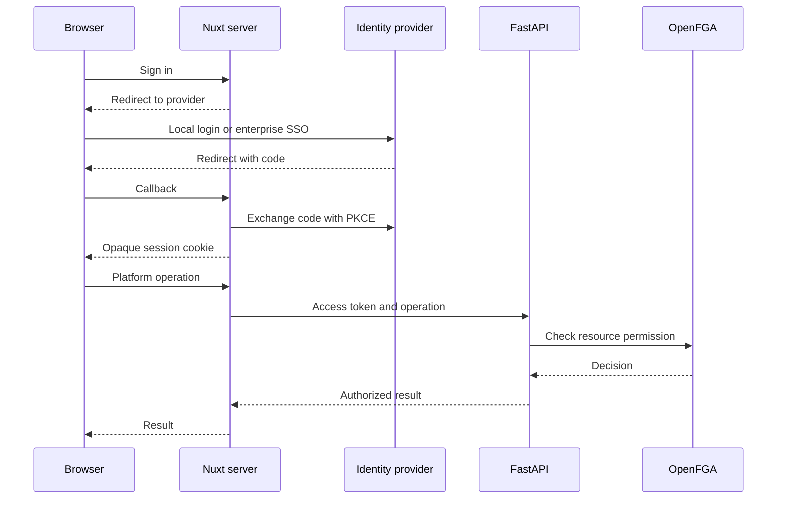

# Platform identity, authentication, and authorization

Status: agreed architectural direction, recorded 2026-11-10; implementation and
production qualification remain future work. [ADR 0013](../decisions/0013-platform-identity.md)
records the boundaries. WU-35 implements only public foundation status: it has
no login, session store, service accounts, or authorization enforcement.

## Protocols and deployment

| Concern | Direction |
|---|---|
| Human login | OIDC Authorization Code flow with PKCE |
| Enterprise SAML | Established broker terminates SAML and exposes OIDC to applications |
| Machine access | OAuth client credentials, audience-scoped short-lived access tokens |
| SDK compatibility | Platform-scoped API keys as another credential type |
| No customer identity provider | Bundled Keycloak with local accounts |
| Customer OIDC provider | Direct integration against a qualified compatibility contract |

OIDC establishes login identity over OAuth. OAuth access tokens authorize API
access; ID tokens are for the login client and are not accepted as API bearer
credentials. SSO is a user experience, not another protocol. SCIM provisioning
is a separate lifecycle integration, not a prerequisite for OIDC login.
See [OIDC Core](https://openid.net/specs/openid-connect-core-1_0.html) and
[OAuth security guidance](https://www.rfc-editor.org/rfc/rfc9700.html).

Deploy the identity provider separately from the start. Keep platform principal,
membership, credential-binding, and authorization integration in modular FastAPI
application code for the MVP. Do not create a custom authentication microservice
or put identity-provider dependencies into the ocai kernel. Extract shared backend
code or services when a second consumer or deployment requirement justifies it.

The reference topology is Nuxt console/server, FastAPI platform/gateway,
Keycloak, OpenFGA, and PostgreSQL. Components have separate database ownership
and credentials even if they share a PostgreSQL installation. Identity-provider
administration remains private and service-authenticated.

## Keycloak selection and alternatives

Keycloak is the selected reference bundled provider, not a required customer
provider. It supports local accounts and external OIDC/SAML brokering. Local
passwords, recovery, MFA, and authentication protections belong to the provider;
the platform stores identity bindings rather than passwords. A branded login
theme can provide a coherent experience without implementing password handling.
See the [administration guide](https://www.keycloak.org/docs/latest/server_admin/).

Selection rationale, based on official documentation checked 2026-11-10:

| Dimension | Evidence and implication |
|---|---|
| Maturity | [CNCF project](https://www.cncf.io/projects/keycloak/) with documented production adopters; useful evidence, not a security certification |
| Maintenance | Active [releases](https://www.keycloak.org/docs/latest/release_notes/) and a dedicated [security response policy](https://www.keycloak.org/security) |
| Enterprise protocols | Local accounts, MFA, OIDC and SAML federation cover the intended reference deployment |
| Licensing | [Apache 2.0](https://github.com/keycloak/keycloak/blob/main/LICENSE.txt), a permissive dependency license; ocai's own license is unchanged |
| Performance | Published [capacity guidance](https://www.keycloak.org/high-availability/multi-cluster/concepts-memory-and-cpu-sizing); our workloads still require measurements |
| Operations | JVM, database, backups, upgrades, and availability need ownership; follow [production guidance](https://www.keycloak.org/server/configuration-production) |

This is a fit assessment, not a comparative performance or security benchmark.
Community security maintenance targets current or subsequent release lines;
customers unable to upgrade regularly need an appropriate supported distribution
and lifecycle agreement. Upstream points to Red Hat's build for long-term support.
Minimize custom extensions and isolate administrative integration behind an adapter.

Alternatives considered, without claiming they are unsuitable or less secure:

- [Authentik](https://goauthentik.io/pricing/): broad protocol support; evaluate
  community versus enterprise boundaries for advanced security and machine identity.
- [ZITADEL](https://zitadel.com/docs): self-hosted OIDC/SAML and modern login;
  its [AGPL licensing policy](https://github.com/zitadel/zitadel/blob/main/LICENSING.md)
  needs assessment for the exact redistribution/customization model.
- [Ory](https://www.ory.com/kratos): modular, API-oriented identity for customized
  experiences; composing components adds integration work. Its integrated B2B,
  SAML, and SCIM offering has commercial feature boundaries. Recheck exact component
  and edition capabilities rather than treating all Ory projects as one license/tier.

Pin and qualify the shipped version. Features listed as supported, preview, or
experimental can change; the product must not inherit a support claim from a
moving latest-documentation URL. Current [feature status](https://www.keycloak.org/server/features)
lists standard token exchange and Kubernetes federation as supported, but SPIFFE
and token-exchange delegation as preview. Preview delegation is outside the
initial production dependency set.

## Local login and enterprise federation

Without an external provider, the bundled provider supplies local login. Disable
public self-registration by default; use controlled, single-use bootstrap for
the first platform administrator. Platform organization onboarding is distinct
from the identity provider's administrative bootstrap. Require privileged MFA
and define restricted, audited emergency access before production.

Enterprise OIDC can connect directly or through the reference broker. Enterprise
SAML terminates at the broker; neither Nuxt nor FastAPI implements a SAML stack.
Local login must not become an automatic bypass when required SSO is unavailable.

Bind users by verified issuer and subject to stable platform principal IDs.
Do not merge accounts by email or infer organization membership from an email
domain alone. Trusted group mappings must be explicitly administered. Changing
issuer/provider requires an audited identity migration, not automatic relinking.
Platform organizations and compartments remain platform concepts, not aliases
for Keycloak realms or provider-specific organization objects.

## Browser and frontend responsibilities

Nuxt's server layer is the console's backend for frontend and owns its OIDC
callback and browser session. There is one owner of that session; FastAPI
validates API credentials rather than maintaining a second console login flow.

- Use an established OIDC library, exact registered callbacks, state/nonce and
  issuer validation, and Authorization Code with PKCE. Do not use the resource
  owner password credentials grant.
- Keep access/refresh tokens in a protected server-side session store, never
  browser local storage or client-visible Nuxt state. The browser receives an
  opaque identifier through a Secure, HttpOnly cookie with a deliberately chosen
  SameSite policy. Rotate the session identifier on authentication transitions.
- Protect state-changing requests against CSRF. Do not shared-cache authenticated
  pages, SSR state, or session responses. Keep runtime secrets server-only.
- Nuxt owns token refresh, session renewal, and local logout. Specify provider
  logout/back-channel support separately; local logout does not invalidate every
  previously issued token. Session persistence and concurrent refresh handling
  must work across replicas.
- Proxy explicit operations to configured upstreams only; reject arbitrary
  destinations and unexpected redirects. Do not blindly forward browser headers.
  WU-35's public status proxy remains credential-free until an owning WU changes it.

| Location | Responsibility |
|---|---|
| `nuxt-ui` | Visual components and design tokens; no identity or API authority |
| `nuxt-platform` | Session presentation, login/logout actions, organization context, permission helpers and route guards |
| Nuxt server modules | OIDC, protected session storage, authenticated API forwarding; server-only secrets |
| `management-client` | Framework-independent typed API operations; no session-store ownership |
| Console features | Product pages and administration workflows |

Frontend guards and hidden buttons improve the experience; the backend enforces
every action. Organization switches clear/rescope caches, selections, subscriptions,
and in-flight responses. Future apps can reuse server integration and layers while
keeping separate OAuth clients and cookies; provider SSO connects their login
experience without a broad cross-application cookie.

## Backend authentication and authorization

Reusable FastAPI dependencies validate supported credentials and produce a trusted
principal context: stable ID, user/service-account type, authentication method,
credential identity/restrictions, and verified issuer/subject when applicable.
Validate issuer, allowed signature algorithms, signature, intended audience, time
constraints and token profile. Untrusted token fields must not select arbitrary
key-discovery endpoints. Resolve organization and compartment against platform
state; caller headers and token roles alone do not establish resource authority.

For a connection-credential rotation: authenticate, resolve organization and
connection, check current membership and credential scope, authorize rotation of
that resource, then perform the change with durable audit evidence.

Effective access is current principal permissions intersected with credential
scope and applicable organization/compartment policies. Resource checks belong
in dependencies/application services that know the action and resource; generic
middleware handles request-wide infrastructure. Enforce lists, direct reads,
exports, writes, streaming admission, and background work. OpenFGA evaluates
relationships and qualified conditions; trusted application code supplies context
and enforces the result. See [relationship queries](https://openfga.dev/docs/interacting/relationship-queries).

Proposed modules stay under `services/gateway/app/identity`, `authorization`, and
`audit`; these are responsibilities, not directories created by this design.
PostgreSQL/OpenFGA synchronization needs explicit ownership, recovery, and
revocation semantics; two independent writes are not one transaction.

Validate qualified JWT access tokens locally with bounded signing-key caches,
rather than contacting Keycloak for every inference request. Platform API keys
have a separate authentication path. Token issuance/refresh, authorization, and
inference workloads need separate capacity measurements. Unknown keys, expired
credentials, or unavailable required authorization cannot produce an allow.
Existing valid tokens during an IdP outage follow a documented validity/revocation
policy; an outage must not silently extend credentials or permissions.

## Non-human identities

Treat a platform service account as a first-class principal. An OAuth client or
API key is a credential binding, not the principal itself. Service-account UI
should expose owner, purpose, organization, compartments, permissions,
authentication methods, expiry/review policy, suspension, and activity history.

| Workload | Authentication/authority model |
|---|---|
| Independent worker, pipeline, scheduled job | Service identity using OAuth client credentials |
| Simple external SDK integration | Scoped platform API key attached to a service account |
| Kubernetes workload | Qualified federated client authentication instead of a stored client secret |
| Agent acting for a user | Explicit delegated authority preserving both subject and actor |

Keycloak service accounts obtain access tokens through client credentials;
client authentication may use a secret or signed JWT assertion. Prefer short
token lifetimes and asymmetric/federated credentials where supported. Map each
independently governed workload/integration to its own identity; avoid one shared
platform bot. Runs get run IDs and constrained execution context, not necessarily
a new Keycloak client for each execution. Never give an ordinary workload broad
identity-provider administration permissions.

Platform API keys are shown once, hashed at rest, scoped, expiring, rotatable,
and revocable. Their authority intersects current principal permissions. Provider
connection secrets are different: they require recoverable protected storage
because the driver must apply them. Neither belongs in prompts or ordinary logs.

Keycloak owns client authentication, registered credentials/federation trust,
token issuance, and authentication events. The platform owns resource grants,
ownership/review workflows, credential bindings, task restrictions, suspension
enforcement, action audit, and usage attribution. Disabling a Keycloak client alone
does not establish immediate rejection of its already-issued JWTs; platform status
checks and cache bounds must implement the advertised revocation guarantee.

## Service interconnection and agent delegation

Every future service validates credentials intended for its API, resolves platform
principals, enforces its resource policies, and records correlated evidence. Calls
need not all traverse the AI Gateway. Do not trust identity headers without an
authenticated, explicitly qualified delegation mechanism, or forward one token
indiscriminately to every downstream service.

Distinguish a maintenance worker acting for itself from a user-triggered agent.
For delegated actions, enforce the intersection of the user's current permissions,
the agent's allowed permissions, delegated task scope, and compartment policies.
Recheck when background work executes; submission-time access is insufficient.
Record subject, actor, delegation, run, action, target and decision with policy
references, without storing bearer credentials. Keycloak authentication events
complement, but do not replace, platform action audit.

Standard token exchange can obtain tokens for downstream audiences within its
supported trust model. Explicit client delegation with subject/actor claims is a
separate capability, currently preview; do not claim standard exchange alone
provides an audited, constrained agent delegation system. Qualified implementations
must reject absent/invalid delegation rather than fall back to the worker's wider
authority. See [Keycloak exchange/delegation](https://www.keycloak.org/securing-apps/token-exchange)
and [RFC 8693](https://www.rfc-editor.org/rfc/rfc8693.html).

External tools, MCP servers and data systems form another credential boundary.
Their OAuth grants/provider credentials are separately scoped and stored; a
platform login token is not automatically valid or appropriate for them. Model
output cannot create grants or expand delegated authority.

## Delivery and qualification

The following are acceptance requirements for subsequent WUs, not tests or
features delivered by this documentation change:

1. First human workflow: persistent state, bundled local OIDC login, controlled
   administrator bootstrap, organization membership, one protected management
   operation, logout, and durable audit of that operation.
2. Resource governance: OpenFGA model, scoped administration, service-account
   lifecycle, API keys and OAuth client-credentials access, suspension and audit.
3. Enterprise/infrastructure integrations: qualified direct OIDC, brokered SAML,
   and Kubernetes federation as separate supported profiles; later SCIM lifecycle.
4. Agent delegation: version-qualified protocol, subject/actor enforcement,
   approval/task constraints, downstream credential boundaries and execution audit.

Exercise wrong issuer/audience, expired tokens, signing-key rotation, CSRF,
cross-organization resource substitution, account-linking attempts, session fixation,
offboarding, revoked keys/membership, replica refresh races, queued jobs, and
IdP/OpenFGA/audit outages. Test list filtering, exports and streams as well as
single-object requests. Verify backups/restores and upgrades, not just clean installs.

Before exposing each workflow, settle session storage/encryption and libraries,
realm/tenant mapping, trusted provider profiles, exact TTL/revocation bounds,
in-flight stream behavior, permission synchronization, and evidence durability.
Publish measured capacity and operating responsibilities; do not invent an SLA.
The implementation queue remains [the MVP plan](../plans/platform-mvp.md).
